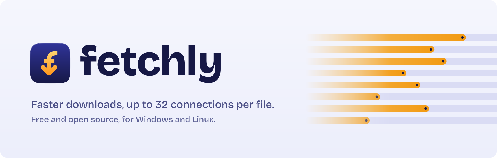
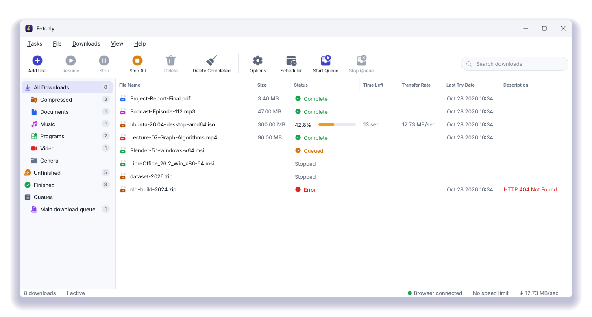
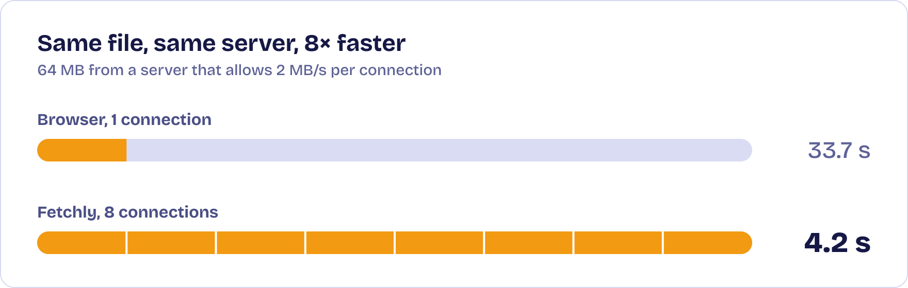
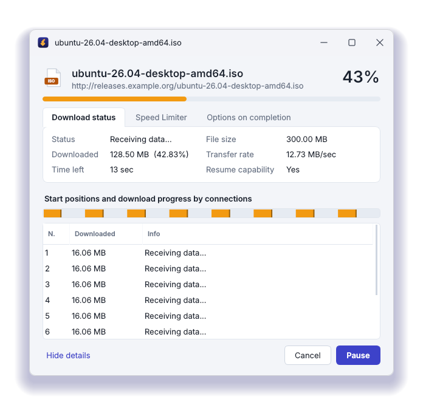
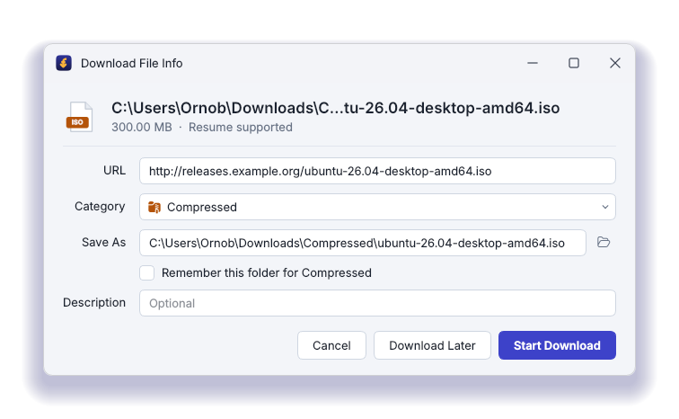

<p align="center">
  <picture>
    <source media="(prefers-color-scheme: dark)" srcset="docs/art/banner-dark.png">
    
  </picture>
</p>

<p align="center">
  <a href="https://github.com/ggvolta/fetchly/releases/latest"></a>
  <a href="https://github.com/ggvolta/fetchly/releases"></a>
  
  <a href="LICENSE"></a>
  <a href="https://github.com/ggvolta/fetchly/actions/workflows/ci.yml"></a>
</p>

<p align="center">
  <a href="https://github.com/ggvolta/fetchly/releases/latest/download/Fetchly-Windows-Setup.exe"><picture>
    <source media="(prefers-color-scheme: dark)" srcset="docs/art/download-windows-dark.png">
    
  </picture></a>
  &nbsp;
  <a href="https://github.com/ggvolta/fetchly/releases/latest/download/Fetchly-Linux-x86_64.AppImage"><picture>
    <source media="(prefers-color-scheme: dark)" srcset="docs/art/download-linux-dark.png">
    
  </picture></a>
</p>

<p align="center">
  <sub>
    Also available: <a href="https://github.com/ggvolta/fetchly/releases/latest/download/Fetchly-Windows-Portable.zip">Windows portable zip</a>
    &nbsp;·&nbsp; <a href="https://github.com/ggvolta/fetchly/releases/latest/download/Fetchly-Browser-Extension.zip">browser extension</a>
    &nbsp;·&nbsp; <a href="https://github.com/ggvolta/fetchly/releases">all releases</a>
  </sub>
</p>

Fetchly is a download manager for Windows and Linux. It splits each file into pieces and downloads them over many
connections at once, picks up where it left off when a download breaks, and takes over downloads from your
browser so you don't have to copy links by hand.

<p align="center">
  <picture>
    <source media="(prefers-color-scheme: dark)" srcset="docs/art/framed-main-dark.png">
    
  </picture>
</p>

## Why it's faster

Many servers cap the speed of each connection. A browser opens one; Fetchly opens up to 32 and gives each a
piece of the file. When a connection finishes its piece, it takes over half of whatever is left of the
slowest one, so every connection stays busy until the last byte.

<p align="center">
  <picture>
    <source media="(prefers-color-scheme: dark)" srcset="docs/art/speed-dark.png">
    
  </picture>
</p>

If one browser download already fills your internet connection, Fetchly can't go beyond it. It helps with
servers that limit each connection, with file hosts and mirrors, and on unstable connections where resuming
saves you from starting over.

## What it does

- Downloads with up to 32 connections per file, and keeps them all busy with dynamic splitting.
- Resumes after a pause, a lost connection, a crash or a restart. If a link expires, paste a fresh one in
  **Properties** and carry on.
- Takes over browser downloads of the file types you choose, with the page's cookies so downloads that need
  you to be signed in still work. Hold **Alt** while clicking a link to let the browser handle that one.
- Shows a **Download this video** button over videos on web pages (direct video files and HLS streams).
  Streaming videos are saved as **MKV** (or MP4, in **Options → Videos**), converted without re-encoding so
  they keep full quality and play and seek smoothly. Fetchly uses ffmpeg for this: it finds an existing copy
  or downloads one the first time it's needed.
- Adds **Download with Fetchly**, **Download all links** and **Download selected links** to the right-click
  menu in your browser.
- Sorts files into Compressed, Documents, Music, Programs and Video, each with its own folder.
- Runs a download queue on a schedule, then exits or shuts the computer down when it's done.
- Also: a speed limiter, batch downloads (`photo*.jpg` from 001 to 100), link import and export, clipboard
  monitoring, drag and drop, proxy support, and light and dark themes that follow your system.

<p align="center">
  <picture>
    <source media="(prefers-color-scheme: dark)" srcset="docs/art/framed-progress-dark.png">
    
  </picture>
  <picture>
    <source media="(prefers-color-scheme: dark)" srcset="docs/art/framed-download-info-dark.png">
    
  </picture>
</p>

## Install

Each release has one file per system. Pick yours:

| Your computer | Download | |
|---|---|---|
| Windows 10 or 11 (64-bit) | [Fetchly-Windows-Setup.exe](https://github.com/ggvolta/fetchly/releases/latest/download/Fetchly-Windows-Setup.exe) | Installer, recommended |
| Windows, without installing | [Fetchly-Windows-Portable.zip](https://github.com/ggvolta/fetchly/releases/latest/download/Fetchly-Windows-Portable.zip) | Unzip and run `Fetchly.exe` |
| Linux (64-bit) | [Fetchly-Linux-x86_64.AppImage](https://github.com/ggvolta/fetchly/releases/latest/download/Fetchly-Linux-x86_64.AppImage) | One file, runs on most distributions |

### Windows

1. Download **Fetchly-Windows-Setup.exe** and run it.
2. The installer isn't code-signed yet, so Windows SmartScreen may warn you: choose **More info**, then
   **Run anyway**. See the [code signing policy](#code-signing-policy).

To uninstall, use **Settings > Apps > Installed apps > Fetchly > Uninstall**. Your downloaded files stay where
they are; the uninstaller asks whether to also remove your settings and download list.

### Linux

1. Download **Fetchly-Linux-x86_64.AppImage**.
2. Allow it to run: right-click the file, open **Properties** and turn on **Allow executing file as program**
   (or run `chmod +x Fetchly-Linux-x86_64.AppImage`).
3. Double-click it. Fetchly offers to add itself to your applications menu, so you can start it from there
   next time.

It works on Ubuntu 22.04 and newer, Debian 12, Fedora, Linux Mint, Pop!\_OS, openSUSE, Arch and other current
distributions. Nothing is installed system-wide.

<details>
<summary>If it doesn't start, or there's no tray icon</summary>

- **Nothing happens when you open it.** Start it from a terminal to see why. If it mentions FUSE, install it
  (`sudo apt install fuse3` on Debian and Ubuntu, `sudo dnf install fuse3` on Fedora) or start Fetchly with
  `./Fetchly-Linux-x86_64.AppImage --appimage-extract-and-run`.
- **No tray icon on GNOME.** Stock GNOME hides tray icons. Install the *AppIndicator and KStatusNotifierItem
  Support* extension (preinstalled on Ubuntu). Without it, Fetchly minimizes to the dock instead.
</details>

To uninstall, untick **Show Fetchly in the applications menu** in **Options**, then delete the AppImage. Your
settings and download list are in `~/.config/Fetchly`.

## Benchmarks

Measured with [`tools/benchmark.py`](tools/benchmark.py), comparing Fetchly with
[aria2](https://aria2.github.io/), a well-known multi-connection downloader written in C++.

| Connections | 1 | 4 | 8 | 16 | 32 |
|---|---|---|---|---|---|
| Fetchly | 2.0 MB/s | 8.0 MB/s | 15.9 MB/s | 31.3 MB/s | 59.9 MB/s |
| aria2 | 2.0 MB/s | 7.9 MB/s | 15.7 MB/s | 30.7 MB/s | 30.6 MB/s* |

Server limited to 2 MB/s per connection, 64 MB file. \*aria2 opens at most 16 connections per server.
With no limit on a local server, Fetchly reaches 520 to 780 MB/s, well beyond any home connection.

## Build from source

```bash
pip install -r requirements.txt
python main.py                  # run Fetchly
python -m tests.test_engine     # run the engine tests
```

Every release is built and tested by [GitHub Actions](.github/workflows/release.yml). To build it yourself:

- **Windows:** run `packaging\build.bat` (the setup file also needs [NSIS](https://nsis.sourceforge.io/)).
- **Linux:** run `packaging/build_linux.sh`. It needs
  [appimagetool](https://github.com/AppImage/appimagetool) and, on Debian or Ubuntu, `libxcb-cursor0`.

<details>
<summary>Project layout</summary>

```
main.py               entry point: one running copy, --tray starts minimized
fetchly/engine.py     segmented HTTP engine, HLS streams, speed limiter
fetchly/manager.py    download list, queue, scheduler, saved state
fetchly/server.py     local API on 127.0.0.1:7614 that the extension talks to
fetchly/ui/           the Qt interface
extension/            Chromium extension (Manifest V3)
packaging/            Windows installer, Linux AppImage and build files
tools/                benchmark, icon and artwork generators
```
</details>

## Limitations

- YouTube, which serves audio and video as separate streams, and DRM-protected services aren't supported.
- Firefox support is planned. There is no macOS version yet.
- No FTP, BitTorrent or website grabber.

## Code signing policy

Free code signing provided by [SignPath.io](https://about.signpath.io), certificate by
[SignPath Foundation](https://signpath.org). Fetchly has applied to their open source program; releases will be
signed once it's approved.

Only files built by [GitHub Actions](.github/workflows/release.yml) from this repository are signed, and every
signing request is approved by hand. Committer, reviewer and approver: [ggvolta](https://github.com/ggvolta).
Fetchly doesn't send information to other networked systems unless you ask it to; see the
[privacy policy](PRIVACY.md). Full details are in the [code signing policy](CODE_SIGNING_POLICY.md).

## Contributing

Bug reports and pull requests are welcome. See [CONTRIBUTING.md](CONTRIBUTING.md) and the
[code of conduct](CODE_OF_CONDUCT.md). Please report security problems privately, as described in
[SECURITY.md](SECURITY.md).

## License

Fetchly is released under the [MIT License](LICENSE). It uses Qt for Python, Fluent UI System Icons and the
Bricolage Grotesque typeface; see [third-party notices](packaging/THIRD-PARTY-NOTICES.txt).
